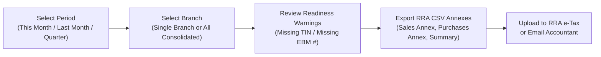

# ExBOS RRA Tax-Ready & Multi-Branch EBM Guide

**Product:** ExBOS (Excellence Business Operations System) by PYLARIX  
**Jurisdiction:** Rwanda Revenue Authority (RRA)  
**Audience:** Business Owners, Branch Managers, Cashiers, and Accountants

---

## 1. What ExBOS RRA Tax-Ready Does (Plain-Language Overview)
ExBOS includes a built-in **RRA Tax-Ready Assistant** designed for Rwandan SMEs.

- **What it IS:** A real-time tax preparation, VAT/Turnover calculation, EBM receipt tracking, and RRA Annex CSV export engine that keeps your books ready for monthly or quarterly RRA e-Tax declarations.
- **What it is NOT (Honest Boundary):** ExBOS does **not** replace your official RRA EBM V2 machine/app and does **not** transmit fiscal invoices directly to RRA servers. Instead, you record your EBM receipt numbers alongside your daily sales and purchases so ExBOS automatically calculates taxes, flags missing supplier TINs before filing, and produces accountant-ready CSV Annexes in one click.

> [!NOTE]
> RRA Tax Tracking is **100% optional**. Businesses that are not yet registered with RRA can keep **RRA Tracking: OFF** so daily POS and receipts remain completely uncluttered.

---

## 2. Subscription Eligibility

| Plan | RRA Settings & Live Preview | CSV Annex Exports, Print Tax Pack & Email to Accountant |
|---|---|---|
| **Forever Free (0 RWF/mo)** | View & configure RRA settings | Locked (upgrade prompt to Bronze+) |
| **Bronze Growth (10,000 RWF/mo)** | Full access | **Included** |
| **Silver Enterprise (20,000 RWF/mo)** | Full access + Multi-Branch TINs | **Included** |
| **Gold Corporate (35,000 RWF/mo)** | Full access + Unlimited Branches | **Included** |
| **Platinum Partner** | Full access + Unlimited Branches | **Included** |

---

## 3. Step-by-Step Setup (Business Owner Only)
*(For security and tax compliance, only the **Business Owner** can edit TINs and tax regimes. Branch Managers have read-only access to their branch's tax settings.)*

### Step A — Configure Main HQ
1. Open **Settings -> RRA Tax & EBM Profile**.
2. Click **RRA Tracking: OFF (Not Ready)** to switch it to **RRA Tracking: ENABLED**.
3. Enter your **9-digit RRA Business TIN** (e.g., `102345678`) and **RRA EBM Branch Code** (default `00` for Main HQ).
4. Select your **RRA Taxpayer Regime**:
   - **Small Taxpayer — 3% Turnover Tax (Non-VAT)** *(businesses under 20M RWF annual turnover)*
   - **VAT Registered — 18% Standard VAT** *(choose **VAT-Inclusive** standard retail `18/118`, or **VAT-Exclusive** `+18% on top`)*
   - **Exempt / Non-Taxable Entity**
5. Choose **Filing Frequency** (`Monthly — due 15th` or `Quarterly — IQP`), optionally enter your **Accountant Email**, and click **Save RRA Tax Profile**.

### Step B — Multi-Branch TIN Configuration (Two Modes Supported)
If your business has multiple branches, use the **Configure Tax & TIN Per Branch** selector at the top of RRA Settings:

| Mode | When to Use | How ExBOS Handles It |
|---|---|---|
| **Inherit Main HQ TIN** *(Default)* | One registered company with multiple shops sharing the **same 9-digit TIN** (e.g., Kigali HQ `00` + Kimironko `01`). | Branch automatically inherits Main HQ's TIN, VAT/Turnover regime, and RRA ON/OFF status while keeping its own **RRA EBM Branch Code** (`01`, `02`, etc.). |
| **Separate Branch TIN** | Distinct legal entities / sister shops under one ExBOS owner login (e.g., Remera Supermarket on **18% VAT** + Musanze Café on **3% Turnover**). | Branch has its own independent **9-digit TIN**, **Tax Regime**, and **RRA ON/OFF** toggle. |

---

## 4. Daily Operations Workflow (POS, Purchases & Receipts)
Once RRA Tracking is **ENABLED** for a branch:
1. **Recording Sales (`Sales -> Record Sale`)**:
   - ExBOS automatically loads the **active branch's** effective TIN and Tax Regime (even offline via local cache).
   - Optional fields appear for **Customer TIN (9 digits)** and **RRA EBM Receipt #**.
   - On 18% VAT-Inclusive sales, ExBOS automatically splits net revenue and VAT (`10,000 RWF` = `8,475 RWF` Net + `1,525 RWF` Output VAT).
2. **Recording Purchases & Expenses**:
   - Enter the **Supplier TIN** and **Supplier EBM Receipt #** on VAT-tagged purchases/expenses.
   - Only purchases with valid Supplier TIN and EBM # are counted as **Claimable Input VAT**—matching RRA audit rules.

---

## 5. End-of-Month RRA Declaration Workflow
Open **Reports -> RRA Tax Center** before the 15th of the month:

### Automatic Readiness Checks (Prevents RRA Penalties)
ExBOS automatically scans your ledger and flags:
- **`MISSING_TIN`**: Business 9-digit TIN is missing or incomplete.
- **`MISSING_SUPPLIER_TIN`**: VAT-tagged purchases missing a Supplier TIN (cannot claim Input VAT).
- **`MISSING_EBM_PURCHASE`**: VAT-tagged purchases missing an EBM Receipt #.
- **`SALES_MISSING_EBM`**: High-value sales (> 50,000 RWF) without an EBM reference number recorded.
- **`MULTIPLE_TINS_DETECTED`**: Shown on *All Branches (Consolidated)* when branches use different TINs—reminding your accountant to select each branch individually before exporting CSVs for RRA e-Tax.

### Available Exports (Bronze+)
- **Sales Annex CSV** (`rra-sales-annex-<period>.csv`) — UTF-8 BOM formatted for Microsoft Excel & RRA e-Tax.
- **Purchases Annex CSV** (`rra-purchases-annex-<period>.csv`) — Clearly marks `RRA Claimable: YES / NO`.
- **Tax Summary CSV** & **Printable RRA Tax-Ready Pack**.
- **1-Click Send to Accountant** — Delivers the period's tax summary directly to your accountant's email.

---

## 6. Rwanda RRA Filing Deadlines Tracked Automatically
- **Monthly Declarations (VAT, PAYE, Withholding Tax 15%)**: Due on the **15th of the following month**.
- **Quarterly Income Tax Prepayment (IQP / Small Taxpayer)**: Due **March 31**, **June 30**, **September 30**, and **December 31**.

---

## 7. Quick Client FAQ
- **Q: What if my business is small and not VAT registered?**  
  Select **Small Taxpayer — 3% Turnover Tax**. ExBOS calculates your estimated 3% turnover tax automatically without adding 18% VAT to your receipts.
- **Q: Can I turn RRA Tracking OFF later?**  
  Yes, click **RRA Tracking: ENABLED** in Settings anytime to pause it without deleting historical sales or purchases.
- **Q: Can my cashier change my company TIN?**  
  No. Branch Managers and staff can only view their branch's tax status; only the Business Owner can edit TINs and tax regimes.
